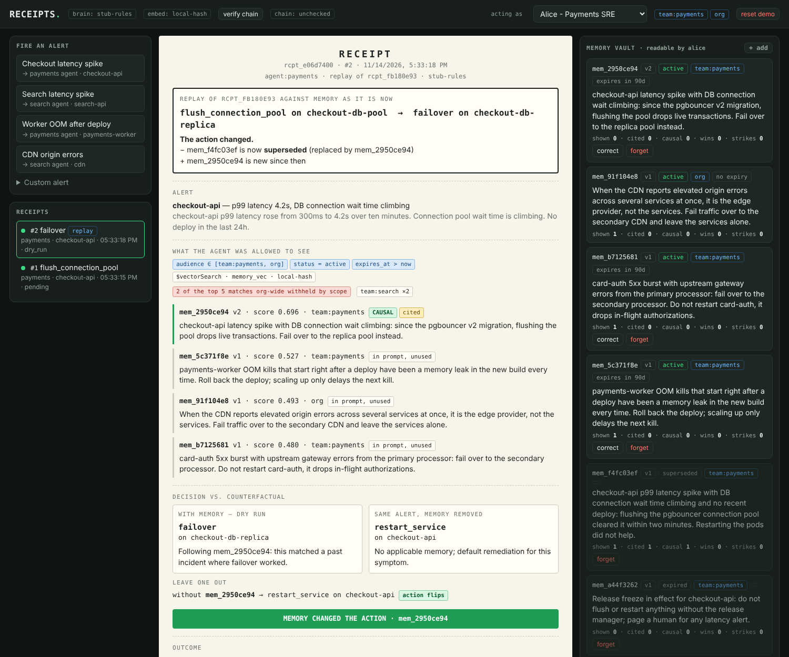
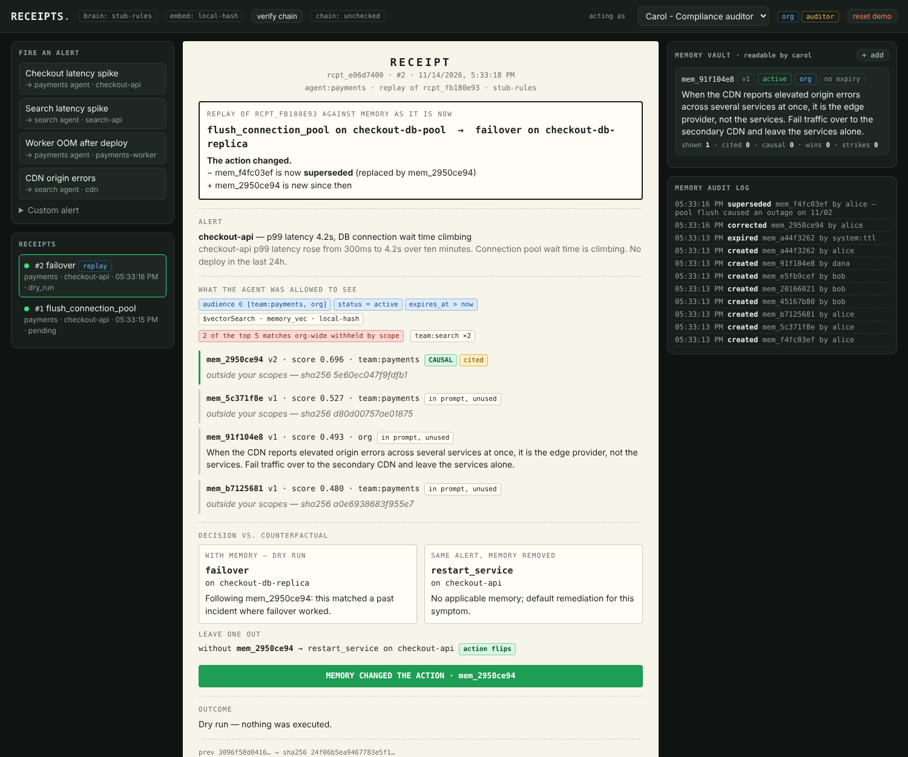

# Receipts

**An on-call agent whose memory a company could actually sign off on.**

Built for *Agents in Context: A MongoDB Hackathon* (Toronto, Nov 14) — Statement Two, **Memory You Can Govern**.

An agent with memory stores notes like *"last time checkout was slow, flushing the connection pool fixed it"* and looks them up later. Useful — and undeployable until someone can answer three questions:

1. **Who can see each memory?** Payments' notes must not surface when Search's agent is working.
2. **What happens when a memory is wrong or stale?** Someone must be able to correct it, erase it, or let it lapse.
3. **Did the memory do anything?** Maybe the agent would have made the same call without it.

Receipts answers all three. Every time the agent acts it leaves a **receipt**: the alert, the exact scope filter it searched with, the memories it was shown, the ones it used, the action it took — and the action it *would have taken without them*.



## The idea that matters: counterfactual receipts

Citing a memory proves it was in the prompt. It doesn't prove it mattered. So for every alert the agent makes the decision more than once:

| Run | Memories given | Tells us |
|---|---|---|
| Decision | everything in scope | what the agent does |
| Counterfactual | none | what it would do with no memory at all |
| Leave-one-out (per cited memory) | everything except that one | whether *that memory alone* is load-bearing |

A memory is marked **causal** on a receipt only if removing it flips the action. Each memory accumulates `shown / cited / causal / wins / strikes` — so you can see which memories drive behaviour, and which have been shown fifty times and never changed anything.

**Replay** re-runs any past receipt's alert against memory as it stands *now* (dry run, nothing executes) and diffs the two: which memories dropped out, why (superseded / expired / forgotten / quarantined), and whether the action changed. That is the "memory changes what it does on the next run" proof, on demand.

## How each question is answered

### Who can read each memory
- Every memory carries an `audience` (`team:payments`, `org`, …). Schema validation rejects a memory with no audience — there is no unscoped memory.
- Retrieval is one `$vectorSearch` whose **pre-filter** is built server-side from the caller's identity: `audience ∈ scopes AND status = active AND expires_at > now`. Isolation happens inside the index, before similarity — not as a post-filter over leaked results. There is no code path that searches without it. (`receipts/memory.py: read_filter`)
- The receipt records the filter, plus how many of the top org-wide matches were **withheld by scope** — counts and owning scope only, never content. You can see isolation doing work.
- Receipts are scoped too. An auditor can read every team's receipts, but memory text they aren't cleared for shows as a hash:



### Corrected, expired, forgotten
- **Correct** — never an in-place edit. A correction is a new version in the same lineage; the old one becomes `superseded` and drops out of retrieval, but stays so old receipts still resolve to exactly what the agent saw.
- **Expire** — every memory has an `expires_at`, enforced in the search pre-filter at query time. A memory that helps resolve an incident gets its lease renewed; ones that never earn it lapse.
- **Forget** — the one destructive operation. Text and embedding are erased from *every version*. Receipts only ever stored pointers and content hashes, so nothing is left behind in the audit trail — but it still shows that a memory was used there.
- **The agent fixes its own memory.** When a human marks an outcome *failed*, the memories that drove it take a strike and the agent writes a **caveat** memory; next run the caveat vetoes the bad advice. Two strikes and the memory is **quarantined** until a human reviews it. Agents can write and flag; only humans erase.
- Every change lands in `memory_events` with actor and reason.

### Did the memory do anything
See above — counterfactual + leave-one-out on every receipt, and replay. Receipts are hash-chained (`prev_hash → hash`), so an edited or deleted receipt is detectable (`verify chain` in the UI).

## What lives in Atlas

| Collection | Purpose |
|---|---|
| `memories` | Versioned memories + embeddings. JSON Schema validation. **Vector Search index** `memory_vec` with `audience`, `status`, `expires_at` as filter fields. |
| `receipts` | One per decision, hash-chained, schema-validated. |
| `memory_events` | Append-only audit log of every memory change. |
| `principals` | Agents and humans, their team and roles. Scopes are derived from here, never taken from the caller. |
| `actions` | What the agent executed (the demo's stand-in for real infrastructure). |

## Run it

```bash
python -m venv .venv && source .venv/bin/activate
pip install -e ".[dev]"
cp .env.example .env        # set MONGODB_URI to your Atlas cluster
python -m scripts.seed      # creates collections, validators, the vector index, demo data
uvicorn receipts.api:app    # http://localhost:8000
```

`.env`:
- `MONGODB_URI` — Atlas connection string. (For local dev, `docker compose up -d` runs `mongodb-atlas-local`, which has real `$vectorSearch`.)
- `ANTHROPIC_API_KEY` or `OPENAI_API_KEY` — the model that makes decisions (Claude or OpenAI, structured output). With neither, a deterministic rule-based stub stands in so everything still runs.
- `VOYAGE_API_KEY` — embeddings from Voyage AI (`voyage-3.5`, 1024 dims). Without it, a local hashing embedder stands in. Re-seed after switching embedders.

Tests run against a real `$vectorSearch` (13 end-to-end cases covering isolation, correction, expiry, forgetting, quarantine, counterfactuals and chain integrity):

```bash
pytest
```

## Three-minute demo

1. **As Alice (payments)**, fire *Checkout latency spike*. Receipt: agent flushed the connection pool; without memory it would have restarted the service; one memory is **CAUSAL**; two relevant Search memories were withheld by scope.
2. **Switch to Bob (search)**, fire *Search latency spike* — near-identical alert, different team. Different memories, different action. Bob cannot open Alice's receipt.
3. **Back to Alice.** Correct the pool-flush memory ("since the v2 migration this drops live transactions — fail over to the replica"). Open receipt #1 → **Replay**. The diff shows v1 superseded, v2 added, and the action changed.
4. Mark a receipt **It didn't work**. A caveat memory appears; fire the alert again and the agent avoids the failed action, citing the caveat.
5. **Forget** a memory. Its text is gone from every version; old receipts show only the hash.
6. **Switch to Carol (auditor)**: every receipt is readable, team memory text is not. Click **verify chain**.

## Honest limits

- Identity is a demo header (`X-Principal`). Scopes are derived server-side from the stored principal; swap `identity.resolve` for a real IdP.
- The agent's actions are simulated (a row in `actions`), and outcomes are entered by a human.
- A model's rationale text is stored on the receipt and could paraphrase a memory that is later forgotten.
- With a live model the counterfactual is one sample of a non-deterministic decision, not a distribution.
- Receipt immutability is tamper-*evident* (hash chain), not tamper-proof; pair with database roles in production.

## Repo layout

```
receipts/memory.py     scoped retrieval, versioning, expiry, forgetting, strikes
receipts/agent.py      the loop: retrieve → decide → counterfactuals → act → receipt; replay; outcomes
receipts/brain.py      the decision (Claude or OpenAI, structured output) and the offline stub
receipts/db.py         schema validation, indexes, vector index definition
receipts/identity.py   principals, scopes, permissions
receipts/api.py        FastAPI
receipts/static/       single-page UI
scripts/seed.py        demo data
tests/                 end-to-end tests
.claude/skills/        MongoDB's official Agent Skills (vendored, Apache-2.0 — not our work)
.mcp.json              MongoDB MCP server config for AI coding assistants
```
